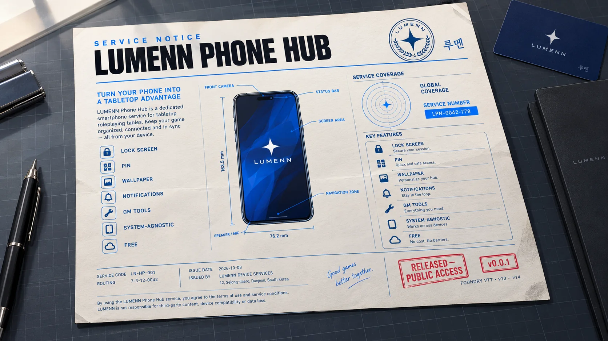

# Lumenn Phone Hub

[](https://github.com/SoftMissT/Lumenn-phone-hub/releases/latest)
[](https://foundryvtt.com)
[](LICENSE)
[](https://github.com/SoftMissT/Lumenn-phone-hub/releases)
[](https://github.com/SoftMissT/Lumenn-phone-hub/issues)

Um **celular diegético** para mesas de **Foundry VTT (v13–v14)**, totalmente **independente de sistema**. Seus jogadores ganham um smartphone dentro do jogo tela de bloqueio, PIN, wallpaper, notificações, relógio do mundo e **seis apps**: Mensagens, Instagram, Fotos, Banco, Notícias e Música. O GM ganha uma central para postar conteúdo, abrir o aparelho de qualquer personagem e redefinir dados.

Sem adaptadores por sistema. Sem backend. Sem dependências externas. Tudo vive no próprio mundo do Foundry.

---

## Status

**Versão `v0.0.12` pronta para instalação.** O gate estático está verde; o QA visual/runtime deve ser feito no Foundry pelo operador.

|                |                                              |
| -------------- | -------------------------------------------- |
| **Versão**     | `0.0.12`                                     |
| **Foundry**    | mínimo `13.350`                              |
| **Sistemas**   | qualquer (system-agnostic)                   |
| **Permissões** | jogador usa o próprio celular · GM usa todos |
| **Licença**    | MIT                                          |

> [!IMPORTANT]
> Os seis apps de conteúdo já existem e são alimentados pela **Central do GM** (e pelos próprios jogadores, no caso do Instagram, das Fotos e do chat de Mensagens). O conteúdo exibido depende das notificações enviadas no mundo e das permissões de arquivo do Foundry.

> [!WARNING]
> O manifesto declara `verified: 14.367`; a validação visual/runtime desta release fica a cargo do operador no Foundry.

---

## Instalação

### Pelo Foundry (recomendado)

1. Abra o Foundry e vá em **Configurações → Módulos → Instalar Módulo**.
2. Cole esta URL no campo **URL do Manifesto**:

```
https://github.com/SoftMissT/Lumenn-phone-hub/releases/latest/download/module.json
```

3. Clique em **Instalar**.
4. Ative **Lumenn Phone Hub** em _Configurações → Gerenciar Módulos_.

### Manual

1. Baixe o `lumenn-phone-hub.zip` na [página de releases](https://github.com/SoftMissT/Lumenn-phone-hub/releases/latest).
2. Extraia para `Data/modules/`, de forma que o caminho final seja `Data/modules/lumenn-phone-hub/module.json`.
3. Reinicie o Foundry e ative o módulo.

**Requisitos:** Foundry VTT **13.350** ou superior. O módulo é system-agnostic não exige nenhum sistema específico.

---

## Como usar

### Jogador

Clique no botão **Celular (Lumenn)** na barra de controles de cena (coluna da esquerda). O telefone abre para o personagem que você está controlando.

Se nenhum personagem estiver atribuído a você, o módulo avisa em vez de abrir uma tela vazia.

**Mensagens:** abra o app na dock, toque numa conversa para ler o histórico e use **Responder...** no rodapé a resposta chega ao celular do outro personagem. Para começar uma conversa nova, use o campo **Para quem?** no topo. Conversas abertas pela Central do GM registram a sua resposta no seu celular e avisam o GM no chat.

### GM

Como GM, o botão abre a **Central do GM**, com:

- **Enviar conteúdo**: título, texto, imagem, áudio e o **app de destino** (Mensagens, Instagram, Fotos, Banco, Notícias, Música ou só notificação);
- **Abrir o celular** de qualquer personagem, em Modo GM;
- **Redefinir PIN** de um personagem;
- **Redefinir wallpaper** de um personagem.

Mensagens enviadas para o app **Mensagens** com um único destinatário caem sempre na mesma conversa daquele personagem.

No **Modo GM** o telefone mostra uma faixa de identificação (`Modo GM {nome}`) para deixar explícito que aquele não é o seu aparelho.

### Sem barra de controles

Se outro módulo conflitar com o grupo de controles, use a macro pronta em [`macros/open-lumenn-phone.js`](macros/open-lumenn-phone.js) ou a API pública.

---

## Recursos

### Phone Shell

Tela de bloqueio, tela inicial, dock, grade de apps, navegação interna, barra de status (sinal, Wi-Fi, bateria), notch genérico, indicador inferior, **temas claro e escuro** e **4 molduras de aparelho**: iPhone, Xiaomi, Oppo e Samsung.

O Shell conhece apenas o **contrato de app**. Os apps de conteúdo se registram por esse contrato (e pela API pública), o que permite adicionar novos sem tocar no shell.

### PIN e bloqueio

- PIN **opcional** de exatamente **6 dígitos**.
- Guardado como **hash + salt**, nunca em texto claro.
- **Throttling** e **lockout progressivo** contra tentativas repetidas.
- Política que rejeita PINs triviais.
- **Reset pelo GM** a qualquer momento.
- A interface de criação/troca/remoção fica em **Ajustes → Segurança**, dentro do próprio celular.

> [!NOTE]
> O PIN é um **lock de privacidade diegético** serve para dar privacidade entre jogadores na mesa. Ele **não** é autenticação forte, não criptografa dados e não é uma barreira contra o GM ou contra o DevTools do navegador.

### Wallpaper

Wallpaper **por personagem**, com validação de arquivo (tamanho, dimensões, tipo). O jogador escolhe do Foundry ou envia do próprio computador; o GM pode definir um wallpaper padrão do mundo e redefinir o de qualquer personagem.

### Notificações

- **Banner** na tela do celular, com **som** configurável.
- **Badge** de não lidas.
- **Lock screen notifications**.
- Estados **unread / read / dismissed**.
- **Persistência narrativa**: as notificações ficam salvas no mundo, com expiração padrão de 7 dias e limite de 200 por personagem.

### Relógio do mundo

Fuso IANA configurável, **ano narrativo** substituível e **rótulo de era** livre (ex.: `AC`, `Era Espacial`). O relógio acompanha a ficção da sua mesa em vez da data real.

### Central do GM

Envio de conteúdo em massa ou para um personagem só título, texto, imagem, áudio e o **app de destino** —, inspeção e controle dos aparelhos, Modo GM e resets: tudo em um só lugar, sem console.

### Apps de conteúdo

Os seis apps são **um motor e seis declarações**: todos leem o mesmo pipeline de notificações.

| App | O que faz |
| --- | --- |
| **Mensagens** | HUD de mensageiro: lista de conversas (avatar, prévia, hora e não lidas) e conversa com bolhas, separador de dia e compositor no rodapé. O botão no canto abre conversa nova com qualquer personagem; **Responder** entrega ao outro celular. Mensagens do GM caem numa conversa do personagem. |
| **Instagram** | Feed de fotos dos personagens com curtidas, stories, abas (Início/Explorar/Perfil) e atalho para Mensagens. |
| **Fotos** | Grade de fotos com visualizador em tela cheia; o jogador adiciona fotos do próprio Foundry/computador. |
| **Banco** | Extrato com saldo somado, crédito/débito coloridos, detalhe ao tocar e símbolo de moeda configurável. |
| **Notícias** | Manchetes com selo de não lida e expansão do artigo no próprio card. |
| **Música** | Cartão "tocando agora" com play/pause pelo AudioHelper do Foundry. |

### Acessibilidade

Navegação por teclado, foco visível, regiões `aria-live` para notificações, suporte a `prefers-reduced-motion`, `prefers-contrast` e `forced-colors`, além de um modo **Reduzir efeitos visuais** dentro de Ajustes.

---

## Para o GM: configurações do mundo

Em _Configurações → Configurar Definições → Lumenn Phone Hub_:

| Configuração | O que faz |
| --- | --- |
| **Fuso horário** | Fuso IANA do relógio (ex.: `America/Sao_Paulo`). Vazio usa o fuso de cada jogador. |
| **Ano narrativo** | Substitui o ano real no celular. `0` mantém o ano real. |
| **Rótulo de era** | Era exibida ao lado do ano (ex.: `AC`, `Era Espacial`). |
| **Wallpaper padrão** | Aplicado a todo celular sem escolha pessoal. |
| **Tema padrão do mundo** | Claro/escuro para quem ainda não escolheu o seu. |
| **Som padrão do mundo** | Liga/desliga o som de quem ainda não escolheu. |
| **Máximo de notificações** | Quantas notificações ficam guardadas por personagem (10–2000; padrão 200). |
| **Retenção (dias)** | Dias até uma notificação expirar (`0` desliga; padrão 7). |
| **Símbolo da moeda** | Símbolo dos valores do Banco (ex.: `R$`). Em branco formata sem símbolo. |
| **Modelo do aparelho** | Moldura: iPhone, Xiaomi, Oppo ou Samsung. |
| **Som de digitação** | Toca um som a cada tecla digitada no telefone. |
| **Banner de notificação** | Mostra o banner quando chega uma notificação. |
| **Upload de wallpaper pelo jogador** | Permite que o jogador envie uma imagem do próprio computador. |
| **Log de depuração** | Logs detalhados do Lumenn no console do navegador. |

Tema, sons e redução de efeitos também são **por jogador**, ajustados dentro do celular em **Ajustes**.

---

## API pública e hooks

Todos os dados do módulo ficam em um `JournalEntry` interno e oculto os personagens não aparecem na sidebar de Diários.

```js
const api = game.modules.get("lumenn-phone-hub").api;

api.openPhone({ actorUuid: actor.uuid }); // abre o celular
api.closePhone(); // fecha
api.openPhoneAsGM(actorUuid); // GM abre o celular de outro (exige GM)

api.notifications.send({
  /* dados da notificação */
});
api.notifications.list(actorUuid);

api.apps.register(definition); // registra um app de conteúdo
api.apps.get(id);
api.apps.list(filter);
```

**Hooks disponíveis:**

`lumennPhoneReady` · `lumennNotificationCreated` · `lumennNotificationReceived` · `lumennAppRegistered` · `lumennPhoneOpened` · `lumennPhoneClosed` · `lumennPhoneDeviceModelChanged`

**Segurança:** o modelo de ameaça, os limites conhecidos e o canal de reporte estão em [SECURITY.md](SECURITY.md).

---

## Desenvolvimento

O código é JavaScript modular, sem etapa de build. Os testes rodam no Node puro, direto sobre os mesmos arquivos que o Foundry carrega:

```bash
node --test
```

São 18 arquivos de teste (67 testes) cobrindo registro de apps, o fluxo de Mensagens (threads e autorização de socket), política e lockout de PIN, o fallback de KDF, validação, envelope de socket, fuso/relógio, validação de wallpaper, modelo e store de notificações, apps de conteúdo e áudio de digitação. O gate completo roda tudo de uma vez:

```bash
node tools/gate.mjs
```

**Estrutura:**

```
scripts/
  compat/        camada de compatibilidade Foundry v13/v14
  core/          constantes, settings, logger, lifecycle, API pública
  apps/          App Registry, apps embutidos (Ajustes, apps de conteúdo, Central/Inspector do GM)
  phone/         shell do telefone e controlador (autoridade GM ↔ socket)
  lock/          KDF do PIN (WebCrypto + fallback puro JS) e lockout
  persistence/   repository, journal store, schemas
  notifications/ modelo, store, banner, áudio e serviço
  wallpaper/     validação, storage e serviço
  socket/        envelope, autorização e runtime de socket
  time/          fuso horário e relógio do mundo
  validation/    validadores de texto, ids e URLs
  ui/            som de digitação
  gm/            serviços do lado do GM (notificações, inspector)
lang/            en, pt-BR
macros/          macro de abertura via API
templates/       Handlebars
styles/          base + temas claro e escuro
tests/           testes do Node (rodam sem Foundry)
tools/           gate.mjs
```

**Compatibilidade:** toda diferença entre v13 e v14 fica isolada em `scripts/compat/`. Se você for contribuir, evite chamar APIs do Foundry direto das telas passe pela camada de compatibilidade.

---

## O que ainda não existe

- **IA para NPCs** reservado no desenho, não implementado;
- **login OAuth / streaming real** o app de Música é um cartão "tocando agora", não um player de Spotify;
- **adaptadores por sistema** e integração com fichas;
- **criptografia ponta-a-ponta** ou PIN como autenticação forte o PIN é um lock diegético (veja [SECURITY.md](SECURITY.md));
- **push notifications fora do Foundry**;
- **aplicativo móvel real**.

A arquitetura acomoda novos apps: cada um se registra pela API pública (`api.apps.register`) e pode adicionar a própria seção na Central do GM.

---

## Licença

[MIT](LICENSE) © 2026 Nelson Antonio Silva Leme Gonçalves
